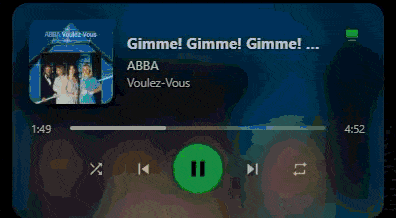
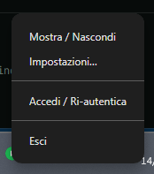
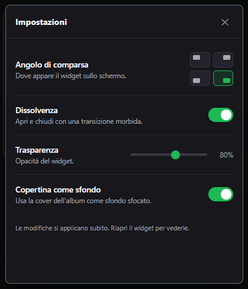

# 🎵 Widget Spotify

**A tiny Spotify remote that lives in the Windows system tray.**
Click the tray icon and a "now playing" card pops up with playback controls, a seek bar,
volume and a device switcher, without opening the Spotify app.

<p align="center">
  <a href="https://github.com/giosci1994/widget-spotify/actions/workflows/ci.yml"></a>
  <a href="https://github.com/giosci1994/widget-spotify/actions/workflows/release.yml"></a>
  <a href="https://github.com/giosci1994/widget-spotify/releases/latest"></a>
  
  
  <a href="LICENSE"></a>
  <a href="https://buymeacoffee.com/giosci1994u"></a>
</p>

<p align="center">
  
</p>

It uses the **Spotify Web API**, so it controls whichever device is currently active on your
account: your PC, your phone or a smart speaker such as an Amazon Echo.

> **Note:** the app's interface is in Italian. The labels quoted below are the ones you will
> see on screen, with an English translation in brackets.

## Contents

- [Features](#-features)
- [Requirements](#-requirements)
- [Installation](#-installation)
- [Setup: connect your Spotify account](#-setup-connect-your-spotify-account)
- [Usage](#-usage)
- [Updates](#-updates)
- [Troubleshooting](#-troubleshooting)
- [Privacy and data](#-privacy-and-data)
- [Development](#-development)
- [Support](#-support)
- [License](#-license)

---

## ✨ Features

- 🎧 **Now playing**: album art, title, artist and album
- ⏯️ **Playback controls**: play/pause, previous/next, shuffle, repeat (off, all, one)
- 🎚️ **Seek bar**: click or drag to jump to any point; it moves smoothly between updates
- 🔊 **Volume**: slider and mute button for the active device
- 🖥️ **Device switcher**: move playback between your PC, phone or speakers
- 🪟 **Lives in the tray**: one click to show or hide; it hides by itself when you click elsewhere
- ⚙️ **Settings**: screen corner, fade animation, transparency, album-art background, launch at startup
- 🔄 **Automatic updates** from GitHub Releases (installer version)
- 🔒 **Secure login**: OAuth with PKCE, so no client secret is needed. The refresh token is
  encrypted with Windows DPAPI.

<p align="center">
  
  &nbsp;&nbsp;
  
</p>

---

## ✅ Requirements

- **Windows 10 or 11.**
- **Spotify Premium.** Spotify only allows playback commands (play, skip, volume, ...) for
  Premium accounts. With a free account the card can still show what is playing.
- **Your own Spotify app (free).** You need to register your own app in the Spotify developer
  dashboard and use its Client ID. Someone else's Client ID won't work: Spotify apps start in
  "Development mode" and only accept the users their owner has added. It takes about
  5 minutes; see [Setup](#-setup-connect-your-spotify-account).

This is an **unofficial** project and is not affiliated with Spotify.

---

## 📦 Installation

Download the latest version from the **[Releases page](https://github.com/giosci1994/widget-spotify/releases/latest)**:

| File | What it is |
|---|---|
| `WidgetSpotify-Setup-x.y.z.exe` | **Installer (recommended).** Lets you choose the install folder, creates a desktop shortcut and updates itself automatically. |
| `WidgetSpotify-portable-x.y.z.exe` | **Portable.** A single executable that runs without installing. It does **not** update itself. |

Run it and a green icon appears in the system tray (you may need to click the **^** arrow
in the taskbar to see it).

> **Windows SmartScreen:** the executables are not code-signed, so Windows may show a
> warning the first time. Click **More info → Run anyway**.

---

## 🔑 Setup: connect your Spotify account

### 1. Create your Spotify app

1. Go to the **[Spotify Developer Dashboard](https://developer.spotify.com/dashboard)**,
   sign in and click **Create app**.
2. Fill in a name and description (anything you like).
3. Under **Redirect URIs**, paste exactly this and click **Add**:
   ```
   http://127.0.0.1:8888/callback
   ```
   Use `127.0.0.1`, not `localhost`.
4. Under the APIs used, tick **Web API**, accept the terms and **Save**.
5. Open your app's **Settings** and copy the **Client ID**. You don't need the client secret.
6. Open **User Management** and add the email address of the Spotify account you'll use.

### 2. Connect the widget

1. Click the tray icon. The card asks for your Client ID.
2. Paste it and click **Salva** (*Save*).
3. Click **Accedi con Spotify** (*Log in with Spotify*). Your browser opens Spotify's
   authorization page.
4. Approve access. The browser shows a confirmation and the card starts showing your music.

**Login doesn't work in your default browser?** Click
**Il browser dà errore? Copia il link di accesso** (*Browser error? Copy the login link*)
and paste the link into a browser where you're already signed in to Spotify.

---

## 📖 Usage

**Left-click** the tray icon to show or hide the card. It also hides when you click anywhere
else.

On the card:
- Click or drag the **progress bar** to seek, and the **volume bar** to change volume.
  Click the speaker icon to mute or unmute.
- Click the **screen icon** at the top right to pick the device to play on.
- If nothing is playing, start a song in Spotify, or click **Scegli dispositivo**
  (*Choose device*) to start playback on a device.

**Right-click** the tray icon for the menu:

| Menu item | What it does |
|---|---|
| **Mostra / Nascondi** | Show or hide the card |
| **Impostazioni…** | Open the settings |
| **Controlla aggiornamenti** | Check for updates (installer version only) |
| **Accedi / Ri-autentica** | Log in again, e.g. to switch account. Your current login stays valid until the new one succeeds. |
| **Esci** | Quit the app |

### Settings

Changes are saved and applied immediately.

| Setting | What it does |
|---|---|
| **Angolo di comparsa** (*Corner*) | Which corner of the screen the card appears in |
| **Dissolvenza** (*Fade*) | Fade the card in and out |
| **Trasparenza** (*Transparency*) | Card opacity, from 50% to 100% |
| **Copertina come sfondo** (*Album-art background*) | Use a blurred copy of the album art as the card background |
| **Avvia all'accensione** (*Launch at startup*) | Start the widget when you log in to Windows |

---

## 🔄 Updates

The **installer version** checks GitHub Releases when it starts and every 6 hours. When a
new version is available it downloads it in the background, then:

- shows a Windows notification;
- adds **⬆ Riavvia e aggiorna** (*Restart and update*) to the tray menu.

The update is also installed automatically the next time you quit the app.

The **portable version** can't update itself: download the new `.exe` from the Releases page
when a new version comes out.

---

## 🩺 Troubleshooting

| Problem | What to do |
|---|---|
| *"Serve Spotify Premium per i comandi"* (Premium required) | Playback commands only work with Spotify Premium. |
| *"Nessun dispositivo attivo"* (No active device) | Start playing something in a Spotify app, or click the screen icon (or **Scegli dispositivo**) and pick a device. |
| The browser shows an error during login | Use **Copia il link di accesso** and open the link in a browser where you're signed in to Spotify. Also make sure the Redirect URI in your Spotify app is exactly `http://127.0.0.1:8888/callback`. |
| *"Porta del login occupata da un altro programma"* (Login port in use) | Another program is using port 8888. Close it and try again, or [change the port](#use-a-different-login-port). |
| *"Accesso scaduto: riprova"* (Login expired) | The login wasn't completed within 5 minutes. Click **Accedi con Spotify** again. |
| The card asks you to log in again | Access was revoked or expired (for example from your Spotify account page). Log in again. |
| *"INVALID_CLIENT"* or *"user not registered"* on Spotify's page | Check the Client ID, and make sure your account's email is listed under **User Management** in your Spotify app. |

### Use a different login port

The port is set in `config.json` (see [Privacy and data](#-privacy-and-data) for where it
lives). To use port 8890, for example:

```json
{ "clientId": "YOUR_CLIENT_ID", "port": 8890 }
```

Then add `http://127.0.0.1:8890/callback` to the Redirect URIs of your Spotify app.

---

## 🔐 Privacy and data

**Where your data is stored:** in `%APPDATA%\widget-spotify\`, on your PC only.

| File | Contents |
|---|---|
| `config.json` | Your Client ID and the login port |
| `settings.json` | Your widget settings |
| `spotify-token.bin` | The Spotify refresh token, encrypted with Windows DPAPI |

**Who the app talks to:**
- **Spotify**: login (`accounts.spotify.com`), playback (`api.spotify.com`) and album art.
- **GitHub**: update checks and downloads (installer version only).

Nothing else is sent anywhere: no analytics, no tracking. To remove your data, quit the app
and delete that folder. You can also revoke the widget's access at any time from your
Spotify account page under **Apps**.

---

## 💻 Development

You'll need **Node.js 22.12 or later** and **Windows** to run the app.

```bash
git clone https://github.com/giosci1994/widget-spotify.git
cd widget-spotify
npm install
npm start
```

On first run, paste your Client ID into the card. For development you can also put it in
a `config.json` in the project root (it's in `.gitignore`):

```json
{ "clientId": "YOUR_CLIENT_ID", "port": 8888 }
```

Or set the `SPOTIFY_CLIENT_ID` environment variable, which takes precedence over both
`config.json` files.

### Scripts

| Command | What it does |
|---|---|
| `npm start` | Run the app |
| `npm run lint` | Check the code with ESLint |
| `npm run format` | Format the JavaScript files with Prettier (`format:check` only checks) |
| `npm run pack` | Build an unpacked app into `dist/` for a quick test |
| `npm run dist` | Build the installer and the portable exe into `dist/` |
| `npm run make-icon` | Regenerate the icons in `assets/` |
| `npm run make-social` | Regenerate `docs/social-preview.png` from `docs/screenshots/widget.png` |

### Project structure

```
src/
  main.js               main process: tray, windows, polling, IPC, auto-update
  auth.js               OAuth PKCE login, token storage and refresh, config loading
  spotify.js            small wrapper around the Web API (/me/player)
  settings.js           persistent settings
  preload.js            secure bridge between the main process and the card
  preload-settings.js   secure bridge between the main process and the settings window
  renderer/             the card (HTML, CSS, JS)
  settings/             the settings window
  shared/theme.css      styles shared by the card and the settings window
scripts/                icon and social-preview generators
docs/                   GitHub Pages landing page, screenshots, demo GIF
assets/                 app and tray icons
```

### CI and releases

- **Every pull request** runs ESLint, the Prettier check and a test Windows build
  ([`ci.yml`](.github/workflows/ci.yml)).
- **Releases** are automatic: push a version tag and
  [`release.yml`](.github/workflows/release.yml) builds on Windows and publishes the release
  with the installer, the portable exe and the update metadata. The version number comes
  from the tag.

  ```bash
  git tag v0.3.0
  git push origin v0.3.0
  ```
- **Dependencies** are kept up to date by Dependabot: one grouped pull request per month for
  minor and patch updates. Major versions are upgraded by hand.

---

## ☕ Support

If Widget Spotify is useful to you, you can buy me a coffee.

<a href="https://buymeacoffee.com/giosci1994u"></a>

## 📄 License

[MIT](LICENSE) © giosci1994
